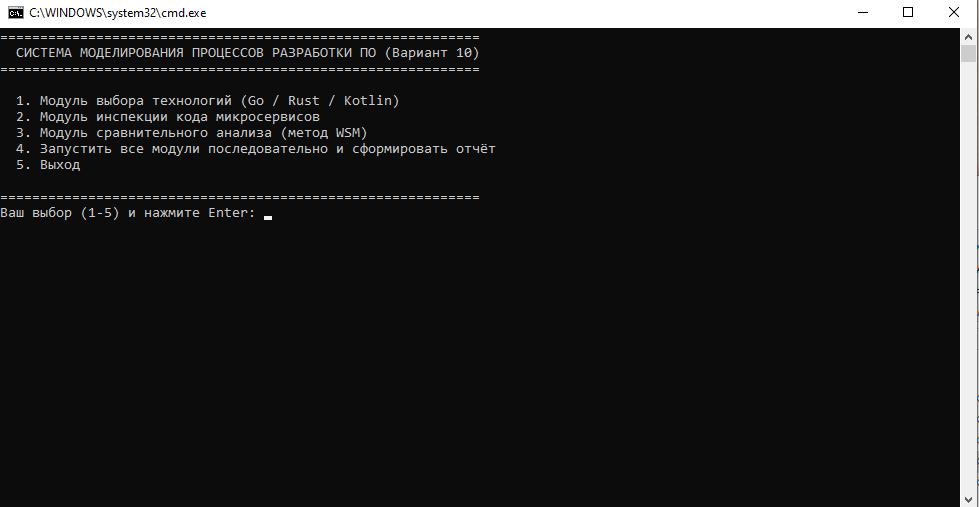
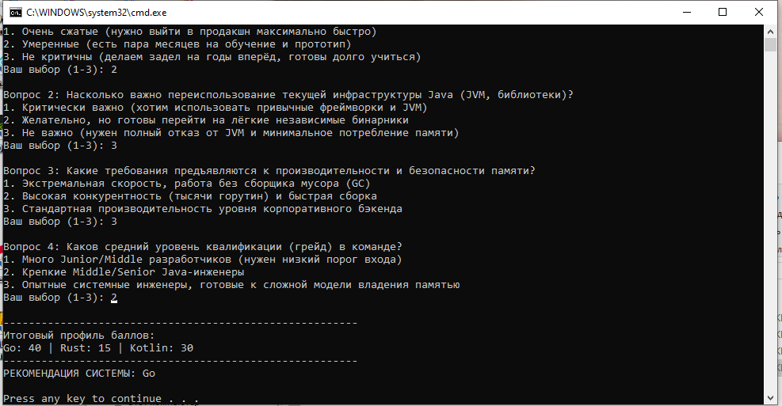
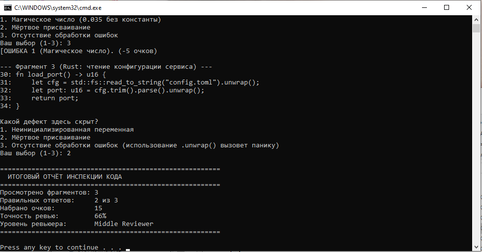
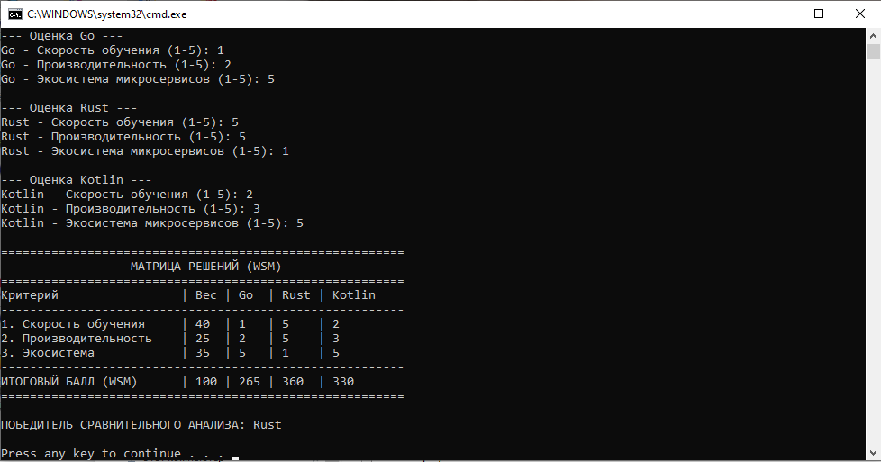
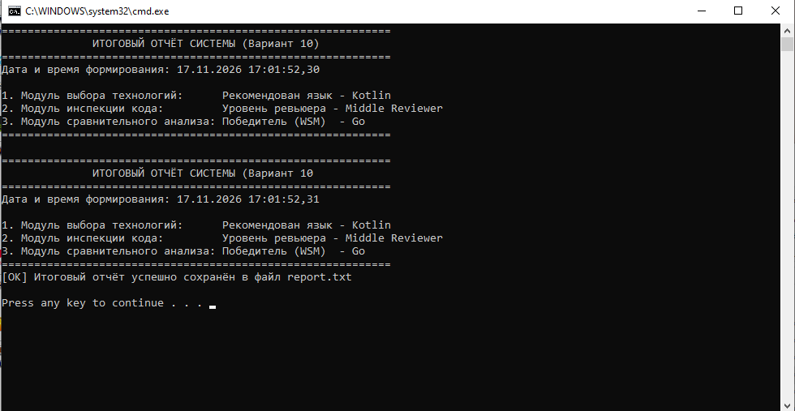

# Лабораторная работа №2
**Тема:** Моделирование процессов принятия решений при разработке ПО  
**Выполнил:** [Карпов Тимофей Дмитриевич]  
**Группа:** [3525П1ИН1]  
**Вариант:** 10 — Выбор языка программирования для обучения команды (Go, Rust, Kotlin; контекст: команда Java-разработчиков осваивает второй язык для микросервисов)  
**Ссылка на репозиторий:** [https://github.com/Pottrah/lab2-decision-system-Karpov/tree/develop]

---

## 1. Листинги модулей с комментариями

### Модуль 1. Выбор технологий (`chapter1.bat`)
Модуль оценивает профиль проекта по 4 критериям (сроки запуска, совместимость с JVM, требования к производительности/памяти, уровень команды). Ветвление реализовано через `choice` и `if errorlevel`, подсчёт баллов — через `set /a`. Итоговая рекомендация сохраняется в переменную `rec_tech`.

```bat
@echo off
chcp 65001 > nul
set score_go=0
set score_rust=0
set score_kotlin=0

echo ========================================================
echo   МОДУЛЬ 1: ВЫБОР ЯЗЫКА ДЛЯ МИКРОСЕРВИСОВ (Вариант 10)
echo   Контекст: Команда Java-разработчиков
echo ========================================================
echo.

echo Вопрос 1: Насколько критичны сроки запуска первого микросервиса?
echo 1. Очень сжатые (нужно выйти в продакшн максимально быстро)
echo 2. Умеренные (есть пара месяцев на обучение и прототип)
echo 3. Не критичны (делаем задел на годы вперёд, готовы долго учиться)
choice /c 123 /n /m "Ваш выбор (1-3): "
if errorlevel 3 (
    set /a score_rust+=15
    goto q2
)
if errorlevel 2 (
    set /a score_go+=15
    set /a score_kotlin+=5
    goto q2
)
if errorlevel 1 (
    set /a score_kotlin+=15
    set /a score_go+=5
)

:q2
echo.
echo Вопрос 2: Насколько важно переиспользование текущей инфраструктуры Java (JVM, библиотеки)?
echo 1. Критически важно (хотим использовать привычные фреймворки и JVM)
echo 2. Желательно, но готовы перейти на лёгкие независимые бинарники
echo 3. Не важно (нужен полный отказ от JVM и минимальное потребление памяти)
choice /c 123 /n /m "Ваш выбор (1-3): "
if errorlevel 3 (
    set /a score_rust+=15
    set /a score_go+=10
    goto q3
)
if errorlevel 2 (
    set /a score_go+=15
    goto q3
)
if errorlevel 1 (
    set /a score_kotlin+=20
)

:q3
echo.
echo Вопрос 3: Какие требования предъявляются к производительности и безопасности памяти?
echo 1. Экстремальная скорость, работа без сборщика мусора (GC)
echo 2. Высокая конкурентность (тысячи горутин) и быстрая сборка
echo 3. Стандартная производительность уровня корпоративного бэкенда
choice /c 123 /n /m "Ваш выбор (1-3): "
if errorlevel 3 (
    set /a score_kotlin+=15
    goto q4
)
if errorlevel 2 (
    set /a score_go+=20
    goto q4
)
if errorlevel 1 (
    set /a score_rust+=20
)

:q4
echo.
echo Вопрос 4: Каков средний уровень квалификации (грейд) в команде?
echo 1. Много Junior/Middle разработчиков (нужен низкий порог входа)
echo 2. Крепкие Middle/Senior Java-инженеры
echo 3. Опытные системные инженеры, готовые к сложной модели владения памятью
choice /c 123 /n /m "Ваш выбор (1-3): "
if errorlevel 3 (
    set /a score_rust+=15
    goto result
)
if errorlevel 2 (
    set /a score_go+=15
    set /a score_kotlin+=10
    goto result
)
if errorlevel 1 (
    set /a score_kotlin+=15
    set /a score_go+=10
)

:result
echo.
echo --------------------------------------------------------
echo Итоговый профиль баллов:
echo Go: %score_go% ^| Rust: %score_rust% ^| Kotlin: %score_kotlin%
echo --------------------------------------------------------

set "rec_tech=Kotlin"
set /a max_score=%score_kotlin%

if %score_go% gtr %max_score% (
    set "rec_tech=Go"
    set /a max_score=%score_go%
)
if %score_rust% gtr %max_score% (
    set "rec_tech=Rust"
    set /a max_score=%score_rust%
)

echo РЕКОМЕНДАЦИЯ СИСТЕМЫ: %rec_tech%
echo.
pause
```
### Модуль 2. Инспекция кода (`chapter2.bat`)
Модуль демонстрирует 3 фрагмента кода микросервисов (на Go, Kotlin и Rust) с типичными дефектами (утечка ресурса, магическое число, отсутствие обработки ошибок). За верный ответ начисляется `+10` очков, за неверный снимается `-5` очков. На основе процента точности присваивается уровень ревьюера (`rev_level`).

```bat
@echo off
chcp 65001 > nul
set score=0
set correct=0
set total=3

echo ========================================================
echo   МОДУЛЬ 2: ИНСПЕКЦИЯ КОДА МИКРОСЕРВИСОВ (Вариант 10)
echo ========================================================
echo Правила: верный ответ = +10 очков, ошибка = -5 очков.
echo.

echo --- Фрагмент 1 (Go: HTTP-клиент микросервиса) ---
echo 10: func fetchUser(url string) ([]byte, error) {
echo 11:     resp, err := http.Get(url)
echo 12:     if err != nil {
echo 13:         return nil, err
echo 14:     }
echo 15:     return io.ReadAll(resp.Body)
echo 16: }
echo.
echo Какой дефект здесь скрыт?
echo 1. Магическое число
echo 2. Утечка ресурса (не закрыт resp.Body.Close())
echo 3. Неинициализированная переменная
choice /c 123 /n /m "Ваш выбор (1-3): "
if errorlevel 3 goto f1_wrong
if errorlevel 2 (
    echo [ВЕРНО!] Забыт defer resp.Body.Close(^), соединение не освобождается. (+10 очков)
    set /a score+=10
    set /a correct+=1
    goto f2
)
:f1_wrong
echo [ОШИБКА!] Правильный ответ: 2 (Утечка ресурса). (-5 очков)
set /a score-=5

:f2
echo.
echo --- Фрагмент 2 (Kotlin: биллинг-сервис) ---
echo 20: fun calculateServiceFee(amount: Double): Double {
echo 21:     val fee = amount * 0.035
echo 22:     return amount + fee
echo 23: }
echo.
echo Какой дефект здесь скрыт?
echo 1. Магическое число (0.035 без константы)
echo 2. Мёртвое присваивание
echo 3. Отсутствие обработки ошибок
choice /c 123 /n /m "Ваш выбор (1-3): "
if errorlevel 2 goto f2_wrong
if errorlevel 1 (
    echo [ВЕРНО!] Коэффициент комиссии 0.035 нужно вынести в именованную константу. (+10 очков)
    set /a score+=10
    set /a correct+=1
    goto f3
)
:f2_wrong
echo [ОШИБКА!] Правильный ответ: 1 (Магическое число). (-5 очков)
set /a score-=5

:f3
echo.
echo --- Фрагмент 3 (Rust: чтение конфигурации сервиса) ---
echo 30: fn load_port() -^> u16 {
echo 31:     let cfg = std::fs::read_to_string("config.toml").unwrap();
echo 32:     let port: u16 = cfg.trim().parse().unwrap();
echo 33:     return port;
echo 34: }
echo.
echo Какой дефект здесь скрыт?
echo 1. Неинициализированная переменная
echo 2. Мёртвое присваивание
echo 3. Отсутствие обработки ошибок (использование .unwrap() вызовет панику)
choice /c 123 /n /m "Ваш выбор (1-3): "
if errorlevel 3 (
    echo [ВЕРНО!] При отсутствии файла или неверном формате сервис упадет с panic! (+10 очков)
    set /a score+=10
    set /a correct+=1
    goto summary
)
echo [ОШИБКА!] Правильный ответ: 3 (Отсутствие обработки ошибок). (-5 очков)
set /a score-=5

:summary
set /a percentage=correct*100/total
set rev_level=Junior Reviewer
if %percentage% geq 80 set rev_level=Senior Reviewer
if %percentage% geq 50 if %percentage% lss 80 set rev_level=Middle Reviewer

echo.
echo ========================================================
echo   ИТОГОВЫЙ ОТЧЁТ ИНСПЕКЦИИ КОДА
echo ========================================================
echo Просмотрено фрагментов: %total%
echo Правильных ответов:     %correct% из %total%
echo Набрано очков:          %score%
echo Точность ревью:         %percentage%%%
echo Уровень ревьюера:       %rev_level%
echo ========================================================
echo.
pause
```

---

### Модуль 3. Сравнительный анализ методом WSM (`chapter3.bat`)
Модуль реализует метод взвешенной суммы (WSM). Пользователь задаёт веса трёх критериев с проверкой, что их сумма равна 100 (`if %total_weight% neq 100`), затем оценивает кандидатов (Go, Rust, Kotlin) по шкале 1–5. Программа вычисляет \(S = \sum(W \times X)\), выводит матрицу решений и определяет победителя (`wsm_winner`).

```bat
@echo off
chcp 65001 > nul

:weights
cls
echo ========================================================
echo   МОДУЛЬ 3: СРАВНИТЕЛЬНЫЙ АНАЛИЗ (МЕТОД WSM) - Вариант 10
echo   Альтернативы: Go, Rust, Kotlin
echo ========================================================
echo.
echo Шаг 1. Назначьте веса критериям (сумма должна быть равна 100):
set /p w1="1. Скорость обучения для Java-разработчиков (например, 40): "
set /p w2="2. Производительность и низкое потребление памяти (например, 35): "
set /p w3="3. Экосистема библиотек для микросервисов (например, 25): "

set /a total_weight=w1+w2+w3
if %total_weight% neq 100 (
    echo.
    echo [ОШИБКА] Сумма весов равна %total_weight%, а должна быть 100! Попробуйте снова.
    pause
    goto weights
)

echo.
echo Шаг 2. Оцените каждый язык по шкале от 1 до 5:
echo.
echo --- Оценка Go ---
set /p g1="Go - Скорость обучения (1-5): "
set /p g2="Go - Производительность (1-5): "
set /p g3="Go - Экосистема микросервисов (1-5): "

echo.
echo --- Оценка Rust ---
set /p r1="Rust - Скорость обучения (1-5): "
set /p r2="Rust - Производительность (1-5): "
set /p r3="Rust - Экосистема микросервисов (1-5): "

echo.
echo --- Оценка Kotlin ---
set /p k1="Kotlin - Скорость обучения (1-5): "
set /p k2="Kotlin - Производительность (1-5): "
set /p k3="Kotlin - Экосистема микросервисов (1-5): "

set /a score_g=g1*w1+g2*w2+g3*w3
set /a score_r=r1*w1+r2*w2+r3*w3
set /a score_k=k1*w1+k2*w2+k3*w3

echo.
echo ========================================================
echo                   МАТРИЦА РЕШЕНИЙ (WSM)
echo ========================================================
echo Критерий                 ^| Вес ^| Go  ^| Rust ^| Kotlin
echo --------------------------------------------------------
echo 1. Скорость обучения     ^| %w1%  ^| %g1%   ^| %r1%    ^| %k1%
echo 2. Производительность    ^| %w2%  ^| %g2%   ^| %r2%    ^| %k2%
echo 3. Экосистема            ^| %w3%  ^| %g3%   ^| %r3%    ^| %k3%
echo --------------------------------------------------------
echo ИТОГОВЫЙ БАЛЛ (WSM)      ^| 100 ^| %score_g% ^| %score_r%  ^| %score_k%
echo ========================================================

set wsm_winner=Kotlin
if %score_g% gtr %score_r% if %score_g% gtr %score_k% set wsm_winner=Go
if %score_r% gtr %score_g% if %score_r% gtr %score_k% set wsm_winner=Rust

echo.
echo ПОБЕДИТЕЛЬ СРАВНИТЕЛЬНОГО АНАЛИЗА: %wsm_winner%
echo.
pause
```
### Главный модуль интеграции (`lab_system.bat`)
Реализует главное меню, вызывает дочерние модули через команду `call` и использует `setlocal enabledelayedexpansion` для агрегации результатов в сводный отчёт.

```bat
@echo off
chcp 65001 > nul
cd /d "%~dp0"
setlocal enabledelayedexpansion

:menu
cls
echo ============================================================
echo   СИСТЕМА МОДЕЛИРОВАНИЯ ПРОЦЕССОВ РАЗРАБОТКИ ПО (Вариант 10)
echo ============================================================
echo.
echo   1. Модуль выбора технологий (Go / Rust / Kotlin)
echo   2. Модуль инспекции кода микросервисов
echo   3. Модуль сравнительного анализа (метод WSM)
echo   4. Запустить все модули последовательно и сформировать отчёт
echo   5. Выход
echo.
echo ============================================================
set "choice="
set /p "choice=Ваш выбор (1-5) и нажмите Enter: "

if "%choice%"=="1" (
    cls
    call "chapter1.bat"
    goto menu
)
if "%choice%"=="2" (
    cls
    call "chapter2.bat"
    goto menu
)
if "%choice%"=="3" (
    cls
    call "chapter3.bat"
    goto menu
)
if "%choice%"=="4" goto run_all
if "%choice%"=="5" exit /b 0

echo.
echo Неверный ввод! Введите цифру от 1 до 5.
pause
goto menu

:run_all
set "rec_tech=Не определено"
set "rev_level=Не определено"
set "wsm_winner=Не определено"

cls
call "chapter1.bat"
cls
call "chapter2.bat"
cls
call "chapter3.bat"

cls
echo ============================================================
echo               ИТОГОВЫЙ ОТЧЁТ СИСТЕМЫ (Вариант 10)
echo ============================================================
echo Дата и время формирования: !date! !time!
echo.
echo 1. Модуль выбора технологий:      Рекомендован язык - !rec_tech!
echo 2. Модуль инспекции кода:         Уровень ревьюера - !rev_level!
echo 3. Модуль сравнительного анализа: Победитель (WSM)  - !wsm_winner!
echo ============================================================
echo.

(
    echo ============================================================
    echo               ИТОГОВЫЙ ОТЧЁТ СИСТЕМЫ (Вариант 10)
    echo ============================================================
    echo Дата и время формирования: !date! !time!
    echo.
    echo 1. Модуль выбора технологий:      Рекомендован язык - !rec_tech!
    echo 2. Модуль инспекции кода:         Уровень ревьюера - !rev_level!
    echo 3. Модуль сравнительного анализа: Победитель (WSM)  - !wsm_winner!
    echo ============================================================
) > "%~dp0report.txt"

echo [OK] Итоговый отчёт успешно сохранён в файл report.txt!
echo.
pause
goto menu
```
---

## 2. Скриншоты работы системы

### Главное меню (`lab_system.bat`)


### Работа Модуля 1 (`chapter1.bat`)


### Работа Модуля 2 (`chapter2.bat`)


### Работа Модуля 3 (`chapter3.bat`)


### Последовательный запуск всех модулей (Пункт 4)


---

## 3. Описание результатов работы интегрированной системы

* **Задаваемые диалоги и вопросы:**
  * В **Модуле 1** система проводит анкетирование по 4 проектным ограничениям: срочность выхода в продакшн, зависимость от экосистемы JVM, требования к производительности/сборке мусора и текущий грейд разработчиков.
  * В **Модуле 2** пользователю поочерёдно предъявляются три листинга микросервисного кода (HTTP-клиент на Go, расчёт комиссии на Kotlin, чтение конфигурации на Rust) с выбором типа дефекта из трёх вариантов.
  * В **Модуле 3** пользователь задаёт процентные веса критериев (с обязательной валидацией суммы 100%) и выставляет экспертные баллы (1–5) каждому языку.
* **Сформированные рекомендации:**
  * При сжатых сроках и опоре на инфраструктуру Java система рекомендует **Kotlin**; при фокусе на высокой конкурентности и быстрой сборке независимых сервисов — **Go**; при экстремальных требованиях к скорости без сборщика мусора — **Rust**.
* **Итоговый отчёт системы:**
  * После последовательного прохождения всех трёх модулей (пункт 4 главного меню) на экран выводится сводный отчёт с датой и временем запуска, выбранным языком программирования, присвоенным уровнем ревьюера (`Junior` / `Middle` / `Senior`) и победителем сравнительного анализа по методу WSM.
* **Впечатления от работы с системой:**
  * Модульная архитектура позволила разработать и протестировать каждый этап принятия инженерных решений изолированно, а затем объединить их в единый конвейер без дублирования кода за счёт передачи переменных окружения через команду `call`.

---

## 4. Инструкция по запуску для пользователя

1. Скачайте архив репозитория (**Code → Download ZIP**) или склонируйте его командой:
   ```bash
   git clone https://github.com/Pottrah/lab2-decision-system-Karpov/tree/develop.git
   ```
2. Распакуйте все файлы в одну локальную папку (убедитесь, что `lab_system.bat`, `chapter1.bat`, `chapter2.bat` и `chapter3.bat` находятся рядом в одном каталоге).
3. Запустите файл **`lab_system.bat`** двойным кликом левой кнопки мыши в Проводнике Windows.
4. В открывшемся главном меню введите цифру нужного модуля (`1`–`3`) или выберите пункт **`4`** для последовательного прохождения всех модулей и получения сводного отчёта.

